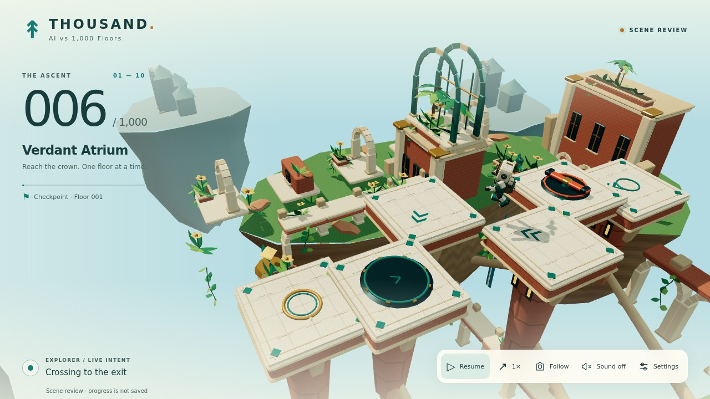

# Game 4 — THOUSAND: Gauntlet progress

## Current verdict: iteration 7 reviewed in the real game; benchmark not passed

Product source `99f4131d7c4510c5a38893bd0602633367643a82` adds a 43-bone expressive cast, ten distinct platform understructures, original district reflection lighting, smoother helmet curvature and camera-readable companion placement. **549 local catalogue tests, 46 focused Game 4 checks and eight actual-game browser tests pass.** Five high-quality WebGL scene stills, four separately labeled isolated-cast shots and an actual worker-driven recording were inspected.

A redundant pre-publication catalogue-wide rerun was stopped by the 200-second command timeout after printing 457 passing subtests and no summary. It is incomplete, not a second full-suite pass; the completed 549/549 result above is retained with its log. A subsequent focused rerun completed 46/46 and the browser build passed.

Read [iteration 7: evidence, corrections and remaining gaps](ITERATION-7.md). [Actual capture artifact](https://github.com/my-edutu/Ai_games/actions/runs/41168794874/artifacts/13030193138) is retained for seven days, to 7 November 2026; scripts are committed for reproduction. The running progress page records each correction and links to the captures and source-specific tests.

**The benchmark remains not passed.** This increment was self-reviewed because the worker service remained offline; no new independent or blind ASTRO BOT judgment is claimed. The fixed camera, contact footprint, campaign and saves remain unchanged. Square landing tops, sparse scenery, small in-game cast scale and motion polish remain open. The recorded software-renderer frame gap reached 2,733 ms; hardware performance, long GPU soak and the two prior high-severity toolchain audit findings are unresolved.

## Historical iteration 6

Source `bfa34ec1fb93d478d5ddb87c051ef8d8f602bd5d` introduced ten district palettes, relief maps, skies and architectural landmarks, with 535 local tests, 32 focused checks and six actual-game browser tests. Its captures reported 26 textures. These are historical counts, not iteration-7 performance. See [iteration 6](ITERATION-6.md).

## Historical evidence through iteration 4

The image, counts and independent reviews below are the historical iteration-4 record, not current iteration-7 performance measurements. Iteration-7 high-quality desktop stills report 31 textures and 102–205 draw calls; no hardware FPS or long-soak result is claimed.

Baseline `d1678cd` named Game 4 in the catalogue but had no playable Game 4 runtime. These captures therefore show the development of a new implementation from that verified starting point.

## Historical iteration-4 evidence

| Piece | Result | Evidence |
|---|---|---|
| Campaign and persistence | Focused checks pass; no remaining P1 found in the final bounded campaign review | [Campaign review 4](campaign-critic-round-4.md) |
| Character, environment and camera | Implemented; sampled exit-clipping defect corrected; reference still preferred | [Visual review 3](visual-critic-round-3.md) |
| Viewer controls and saved progress | Six Chromium functional checks pass in the supported low tier | [Verification record](VERIFICATION.md) |
| Resource lifecycle | Ten real generated district snapshots return to the exact initial 50 geometries / 13 textures | [Machine-readable evidence](../../../evidence/thousand-floors/verification.json) |
| High-quality performance and production operation | Unverified; high-tier capture is slow on this host | No hardware FPS or long-soak claim |

## Iteration history

1. **Baseline:** isolated branch, fixed references and shared interfaces. No existing runtime was passed off as a previous playable version.
2. **Iteration 1:** worker-driven campaign, original first cast and 3D platforms. [Desktop](../../../evidence/thousand-floors/captures/iteration-1-desktop.jpg), [portrait](../../../evidence/thousand-floors/captures/iteration-1-mobile.jpg). The [first visual critic](visual-critic-round-1.md) preferred the reference and returned environment depth, material distinction, articulation and mobile framing. [Campaign review 1](campaign-critic-round-1.md) found hazard-contact and impossible-save defects.
3. **Iteration 2:** stronger platform dressing, compact portrait HUD, interpolation and low exit beacon. [Desktop](../../../evidence/thousand-floors/captures/iteration-2-desktop.jpg), [portrait](../../../evidence/thousand-floors/captures/iteration-2-mobile.jpg). [Campaign review 2](campaign-critic-round-2.md) verified the contact fix and exposed reward/phase inconsistencies; [review 3](campaign-critic-round-3.md) found the final recovery-expiry invariant. Builders corrected each with regression evidence.
4. **Iteration 3:** a skinned articulated explorer, richer architecture/materials and geometry batching. [Desktop](../../../evidence/thousand-floors/captures/iteration-3-desktop.jpg), [portrait](../../../evidence/thousand-floors/captures/iteration-3-mobile.jpg). The [second visual critic](visual-critic-round-2.md) found an upcoming exit entering view too late and a world still dominated by isolated slabs.
5. **Iteration 4:** connected cliff terraces, lower galleries and distant settlements; anticipatory framing uses the authoritative route cursor and a stable scale. [Desktop](../../../evidence/thousand-floors/captures/iteration-4-desktop.jpg), [portrait](../../../evidence/thousand-floors/captures/iteration-4-mobile.jpg), [motion excerpt](../../../evidence/thousand-floors/captures/iteration-4-motion.mp4). Actual later-district captures: [Aqueduct, floor 102](../../../evidence/thousand-floors/captures/district-2-aqueduct.jpg), [Coral Archive, floor 403](../../../evidence/thousand-floors/captures/district-5-coral.jpg), [Crown, floor 902](../../../evidence/thousand-floors/captures/district-10-crown.jpg). The latest critic no longer reproduced the prior exit clipping in the sampled traversal and found no new actor/next-landing obstruction in the inspected material.

## Historical iteration-4 gaps

The largest presentation gap is district-specific primary architecture and material finish: repeated square caps, brick towers and regular surface treatment remain prominent. The agent follows one generated route per floor; alternative route selection is not implemented. The high-quality recordings are slow on this shared host, so real-time animation quality and hardware frame rate require further evidence. Broader accessibility, audio listening quality, context-loss recovery and production soak remain open.

No blind study is claimed: recognizable characters and HUDs reveal the sources. The [reference manifest](reference-evidence.md) records official clips, exact timestamps and comparison limits. Reference assets are not shipped as original game art. `ultracode` is unavailable in this environment; independent builder/fresh-critic roles were executed with the available subagents.

## Later iterations

6. **Iteration 5:** [compact UI and Journey panel](UI-ITERATION-5.md), originally verified through UI fixtures.
7. **Iteration 6:** [distinct district architecture and real-game verification](ITERATION-6.md), actual browser checks and captures, author self-review. No benchmark win claimed.

## Run and inspect

From the repository root: `npm ci`, then `npm run floors:stream`. Open **http://localhost:4184/floors/** and **http://localhost:4184/floors/progress**. The latter refreshes its evidence record every five seconds while open; it does not itself launch builders or create new iterations. See the [game README](../../../games/ai-vs-1000-floors/README.md) for controls, review URLs and validation commands.

## 31 October 2026 — iteration 7: cast, stage and visual corrections

Source `99f4131d7c4510c5a38893bd0602633367643a82` completes three implemented/self-reviewed revisions: articulated cast and district platform geometry (`9e2b387`), original reflection lighting after a flat-material finding (`726e570`), and smoother helmet plus camera-readable companion (`99f4131`). No campaign/save/landing-footprint changes.

Fresh results: **549/549 local catalogue tests**, **46/46 focused Game 4 tests**, **8/8 actual-game low-tier Chromium tests**, and both runtime builds. Five actual high-quality scene stills and a worker-driven recording were inspected; four additional cast shots are explicitly isolated fixtures, not gameplay. Final scene diagnostics report 31 textures, and the software motion session shows a 2,733ms maximum observed frame gap. Hardware performance/soak are not established.

[Iteration record and rulings](ITERATION-7.md) · [Exact-source browser run](https://github.com/my-edutu/Ai_games/actions/runs/41168794874) · [Capture artifact, seven-day retention](https://github.com/my-edutu/Ai_games/actions/runs/41168794874/artifacts/13030193138) · [Short continuation prompt](CONTINUE_PROMPT.md).

**Reference benchmark not passed.** The independent worker/ultracode path remains unavailable, and no fresh blind reference judgment was run. Self-review found improved silhouette separation and platform diversity, but square tops, sparse terrain, conservative cast scale and continuous-motion polish remain open. This is a draft review increment, not a merge, deployment or unattended loop.
